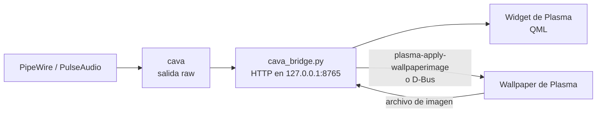

# Cava Viz

[English](README.md) | **Español**

Un widget visualizador de audio para el escritorio de KDE Plasma 6. Dibuja barras finas y reactivas directamente sobre el wallpaper (sin ventana ni fondo) y adapta sus colores al wallpaper actual. También incluye su propia rotación de wallpapers para que los colores siempre coincidan con la imagen en pantalla.


| Panel de configuración | Otro wallpaper |
|---|---|
|  |  |

## Características

**Wave**
- La cantidad de barras se ajusta sola al ancho del widget; solo eliges grosor y hueco en píxeles.
- Cuatro estilos: barras redondeadas, barras rectas, onda (una curva suave rellena) y circular (barras alrededor de un círculo).
- Tres orientaciones para barras y onda: desde abajo, espejo (con línea de reflejo ajustable) y flotante (centrada).
- Movimiento suave: un deslizador opcional que suaviza el movimiento (sube más rápido de lo que baja, así los golpes se siguen notando).
- Stereo o mono, con distribución de frecuencias normal o invertida.
- Peaks, ocultar en silencio y transiciones suaves de color.
- Glow que pulsa con los graves, con el color de la barra o un color de contraste automático.

**Estilos**
- Guarda el aspecto actual (forma, colores, glow, movimiento suave) con un nombre y vuelve a él con un clic, además de 5 estilos listos (Configurar > Estilos).

**Modos de color**

| Modo | Qué hace |
|---|---|
| Dos colores | Los graves usan el color de acento de Plasma y los agudos se mezclan hacia el color del wallpaper más distinto a él, o eliges tú los dos colores |
| Por zona del fondo | Cada barra toma el color de la zona del wallpaper donde está, siempre claro y saturado para que se vea. Opción para intercambiar colores entre zonas |
| Degradado del fondo | Los colores principales del wallpaper (hasta 4), repartidos de graves a agudos |
| Por intensidad | Las barras bajas usan un color del wallpaper y las altas otro: el color sube con el volumen |
| Color fijo | Un color que eliges tú |
| Paleta | Una paleta lista (Neón, Atardecer, Océano, Fuego, Bosque, Hielo, Pastel, Arcoíris) o la tuya (de 2 a 6 colores), de graves a agudos |

Todos los modos que usan el wallpaper también siguen a un fondo de video.

**Wallpaper**
- Rotación desde una carpeta: aleatorio, alfabético o más recientes primero, con intervalo en horas, minutos y segundos.
- "Siguiente wallpaper" desde el menú de clic derecho del widget o con un atajo de teclado.
- Reutiliza la carpeta y las imágenes excluidas de la configuración de presentación de Plasma.
- **Turnos de imágenes de we-fetch:** si [we-fetch](https://github.com/kendoulises05-svg/we-fetch) turna imágenes y videos en el escritorio (su servicio `we-fetch-desktop-turns`), Cava Viz no rota imágenes encima y "Siguiente wallpaper" le pide a we-fetch el siguiente turno.
- **Fondo de video** (plugin Smart Video Wallpaper Reborn, el que pone [we-fetch](https://github.com/kendoulises05-svg/we-fetch)): los colores salen de un fotograma del video que se está viendo (se sabe cuál por el archivo que tiene abierto plasmashell; con ffmpeg, en caché en `~/.cache/cava-viz/frames`) y "Siguiente wallpaper" pasa al siguiente video del plugin. Mientras el fondo sea video, la rotación por tiempo no pone imágenes encima: los videos los rota el plugin.

**Consumo de recursos**
- Pausa cava y oculta el widget cuando una ventana lo tapa (configurable: nunca, solo pantalla completa, pantalla completa o maximizada, o cualquier ventana que tape el widget, incluido tiling) o la pantalla está bloqueada.
- Se puede apagar y encender a mano desde el clic derecho o con un atajo (`/toggle`); el estado se conserva tras reiniciar.
- Se pausa mientras cava corre en una terminal (por ejemplo Konsole), para ver solo ese; es opcional.
- cava en Konsole con los colores del wallpaper: `cava -p ~/.config/cava/terminal.conf` (`install.sh` copia `terminal.conf`; el puente actualiza sus colores al abrirlo y al cambiar de wallpaper).
- Los cálculos de color se guardan en caché y solo se recalculan cuando cambia el wallpaper, el modo o la posición del widget.

## Requisitos

- KDE Plasma 6 (desarrollado y probado en Kubuntu 26.04 con Plasma 6.6.6, Wayland)
- PipeWire o PulseAudio
- `cava`, `python3-pil` (Pillow) y `curl`. El instalador agrega los que falten con `apt`.
- `plasma-apply-wallpaperimage` y `qdbus6` (incluidos con Plasma)

## Instalación

```bash
git clone https://github.com/kendoulises05-svg/cava-viz.git
cd cava-viz
./install.sh
```

El script instala las dependencias que falten, copia la configuración de cava (nunca sobrescribe una existente), crea e inicia el servicio de usuario `cava-bridge`, e instala o actualiza el widget. Pregunta antes de recargar el escritorio.

Solo la primera vez: clic derecho en el escritorio > **Add Widgets** > **Cava Viz**, y ajusta su tamaño al área que quieras.

Ejecuta `./install.sh` de nuevo después de cada actualización. Para quitar todo:

```bash
./install.sh --uninstall
```

Esto quita el servicio y el widget; tu configuración de cava y tus wallpapers no se tocan.

## Configuración

Clic derecho sobre el widget > **Configure Cava Viz**:

| Página | Opciones |
|---|---|
| Estilos | Guardar, usar, reemplazar y borrar estilos; estilos listos |
| Wave | Estilo, movimiento suave, grosor y hueco, orientación, línea del espejo, canales y distribución de audio, glow, fps, pausar cuando, pausa con cava en terminal, peaks, ocultar en silencio |
| Color | Modo de color y sus opciones (mezcla del accent, intercambio de colores entre zonas, color fijo, paleta) |
| Wallpaper | Activar rotación, carpeta, orden, intervalo, botón de siguiente wallpaper |
| Keyboard Shortcuts | Atajo para "siguiente wallpaper" |

Los modos que usan el wallpaper (dos colores, por zona, degradado, intensidad) necesitan que Cava Viz controle el wallpaper. Si la presentación propia de Plasma está activa, el widget usa el color de acento (ver [Limitaciones conocidas](#limitaciones-conocidas)).

## Cómo funciona



Los widgets de Plasma no pueden leer la salida continua de un proceso, así que un pequeño puente en Python ejecuta cava, guarda el último frame y lo sirve por HTTP, escuchando solo en `127.0.0.1`. El mismo puente rota el wallpaper, lee la imagen con Pillow y calcula los colores de cada modo.

| Archivo | Función |
|---|---|
| `cava_bridge.py` | Puente: proceso de cava, servidor HTTP, rotación de wallpaper, modos de color, pausas |
| `org.kendo.cavaviz/` | El widget de Plasma (QML) y sus páginas de configuración |
| `raw.conf` | Configuración base de cava; el puente solo cambia `bars` y `channels` en una copia temporal |
| `install.sh` | Instalador y desinstalador |

Endpoints del puente, útiles para scripts:

| Endpoint | Función |
|---|---|
| `/` | Último frame de cava (`P` en pausa, `D` apagado a mano) |
| `/next` | Siguiente wallpaper |
| `/disable`, `/enable`, `/toggle` | Apagar, encender o alternar el visualizer (se conserva tras reiniciar) |
| `/state` | `off` si está apagado a mano, `on` si no |
| `/terminal?pause=1\|0` | Pausar o no mientras otro cava corre (lo manda el widget) |
| `/pause`, `/resume` | Pausar o reanudar cava (los usa el widget cuando una ventana lo tapa) |
| `/bars?n=&ch=` | Cantidad de barras y `stereo` / `mono` |
| `/palette`, `/zones` | Colores del wallpaper (JSON) |
| `/rotation?enabled=&dir=&seconds=&order=` | Configuración de la rotación |

Para asignarlos a atajos de teclado: System Settings > Keyboard > Shortcuts > Add New > Command or Script, con uno de estos comandos:

```bash
curl -s http://127.0.0.1:8765/toggle   # apagar / encender el visualizer
curl -s http://127.0.0.1:8765/next     # siguiente wallpaper
```

## Rendimiento

Medido el 2026-10-07 con [`tools/bench.sh`](tools/bench.sh): promedio real de 10 s por escenario, con música sonando. Laptop HP, Kubuntu 26.04, Plasma 6.6.6 (Wayland). Configuración: 194 barras, 45 fps, glow activo, espejo, color automático.

| Escenario | plasmashell | cava | puente | Total |
|---|---|---|---|---|
| Widget visible (activo) | 28.7% | 1.9% | 3.3% | 33.9% |
| Pantalla completa | 8.5% | 0.0% | 0.0% | 8.5% |
| Apagado manual | 8.5% | 0.0% | 0.0% | 8.5% |
| Tiling parcial con "Pausar cuando: pantalla completa o maximizada" (no pausa) | 32.9% | 1.9% | 3.4% | 38.2% |

Estilos y modos, medido el 2026-10-18 (190 barras, 45 fps, glow, espejo, fondo de video; el total incluye el ~9% del panel y otros widgets):

| Configuración | plasmashell | Total |
|---|---|---|
| Barras redondeadas, por zona (referencia) | 30.4–32.1% | 36.0–37.9% |
| Onda | 31.5% | 37.3% |
| Circular | 20.9% | 26.8% |
| Barras, por intensidad | 30.4–34.0% | 36.6–40.8% |
| Onda, por intensidad | 26.5% | 33.0% |
| Barras, degradado del fondo | 28.5% | 34.4% |
| Barras, movimiento suave 60% | 39.7% | 46.0% |

- Los colores se calculan una vez por cada cambio de color, nunca en cada frame. "Por intensidad" tampoco calcula un color por barra: las barras se dibujan una vez como máscara sobre un solo degradado vertical (MultiEffect).
- La onda es una sola figura (`QtQuick.Shapes`, un path SVG que se arma una vez por frame); el circular muestra menos barras (las que caben alrededor del círculo).
- El movimiento suave cuesta ~8 puntos más: las barras siguen moviéndose entre frames de cava, así que el widget redibuja en cada consulta en vez de saltarse los frames repetidos. Viene apagado.

Cómo leer la primera tabla:

- **plasmashell también dibuja el panel y los otros widgets.** Con Cava Viz apagado se midió 9.4%, así que ese ~9% no es de Cava Viz. Lo propio de Cava Viz es ~20% activo y ~0% en pausa.
- **En pausa, cava se congela** (estado `T`) y cava y el puente caen a 0%.
- **Tiling:** con la opción "Pantalla completa o maximizada" el tiling no cuenta y el widget sigue dibujando detrás. Con "Una ventana tapa el widget" (la opción por defecto) también se pausa.

Comparado con la medición anterior (muestra instantánea de `top`, solo plasmashell: glow a 60 fps ~31%, glow a 30 fps ~16%, sin glow a 30 fps ~13%, en pausa ~0%):

- **Activo:** ~20% propio a 45 fps con glow y espejo, entre los valores anteriores de 30 y 60 fps. Lo esperable: la pausa por ventana y el apagado manual no agregaron costo medible.
- **Mejora:** antes una ventana maximizada o en tiling no pausaba nada (~34% del total seguía corriendo). Ahora Cava Viz baja a ~0% en esos casos.
- No es una comparación 1 a 1: antes se medía con `top` (una muestra) y con otra configuración. Desde ahora, `tools/bench.sh` permite repetir la misma medición antes y después de cada cambio.

### Medir tú mismo

```bash
cd ~/cava-viz && tools/bench.sh
```

El script te guía por cada escenario: activo, pantalla completa, ventana que tapa el widget, cava en Konsole y apagado manual (este último lo hace solo). Otras formas de usarlo:

```bash
tools/bench.sh --now "glow 30 fps"     # mide solo lo que hay en pantalla ahora, sin preguntas
SECS=20 tools/bench.sh                 # mediciones de 20 s en vez de 10
```

Los resultados se guardan en `~/.local/state/cava-viz/bench/`. Para comparar un cambio: mide, aplica el cambio, mide otra vez y compara la columna **total** y la fila **Apagado manual**.

## Solución de problemas

| Problema | Revisa |
|---|---|
| El widget no muestra barras | `curl -s http://127.0.0.1:8765/` debe devolver números. Si no: `journalctl --user -u cava-bridge -n 20 --no-pager` |
| El widget muestra un error de QML | `journalctl --user -u plasma-plasmashell -n 30 --no-pager \| grep -iE "cavaviz\|qml"` |
| Todas las barras en 0 | cava escucha la fuente equivocada. Lista las fuentes con `pactl list short sources` y pon la que termina en `.monitor` en `~/.config/cava/raw.conf` (`source = ...`); luego `systemctl --user restart cava-bridge` |
| El wallpaper no cambia | El log del puente muestra el motivo exacto que da Plasma |
| El escritorio no reinicia ("start request repeated too quickly") | `systemctl --user reset-failed plasma-plasmashell` y `systemctl --user start plasma-plasmashell` |

Recarga solo lo que cambió:

| Cambiaste | Comando |
|---|---|
| `cava_bridge.py` o `raw.conf` | `systemctl --user restart cava-bridge` |
| Archivos del widget | `./install.sh` |

## Limitaciones conocidas

- **Presentación de Plasma:** Plasma no expone qué imagen está mostrando su presentación (ni en su archivo de configuración ni por D-Bus), así que los modos de color basados en el wallpaper necesitan la rotación propia de Cava Viz.
- **Wallpapers con mucho detalle:** con muchas zonas pequeñas de color, el modo por zona las promedia y puede elegir colores que no se vean bien.
- **Una sola pantalla:** probado solo con un monitor.
- **Fondo de video:** los colores siguen al video y cambian justo en los cortes. La primera vez que se ve un video, el puente lo prepara en segundo plano: 2 fotogramas por segundo de una pasada con prioridad baja (con decodificación por hardware VA-API un video de 125 s tarda ~4,5 s; sin ella usa solo los fotogramas clave) y lo divide en tramos de color estable (cambios de escena). Cada respuesta de colores incluye los del tramo siguiente y en cuántos ms empieza, y el widget programa el cambio para ese momento (0,25 s antes, lo que dura la transición). El momento del video se cuenta con un reloj desde que empieza o vuelve a empezar; la lectura del archivo por plasmashell solo detecta inicio, repetición y pausas (si se desfasan más de 3 s, se corrige). Para que vaya **exacto**, `install.sh` instala una copia del plugin de video en `~/.local/share/plasma/wallpapers/` (`video_plugin.py`) que solo agrega un aviso: cada 0,5 s le dice al puente en qué segundo va el video y si está en pausa (`/videopos`; en el lock screen no corre). No hace falta ningún comando: el puente revisa cada 10 s y crea la copia si falta o la rehace si el plugin del sistema se actualizó (si el aviso ya no encaja, la quita y queda el original). Para que Plasma la use sin reiniciar el escritorio, recarga solo el fondo de video (lo cambia a imagen y vuelve al video 1,5 s después; la config del video se conserva): lo hace al escribir una copia nueva y, una vez por sesión de Plasma, si el fondo es video pero el aviso no llega en 15 s. `./install.sh --uninstall` la borra. Sin esa copia se usa la estimación anterior, ajustable con `VIEW_DELAY` (0,5 s) en `cava_bridge.py`. Se guardan hasta 30 videos preparados.

## Licencia

GPL-3.0 o posterior. Ver [LICENSE](LICENSE).

## Autor

Kendo ([kendoulises05-svg](https://github.com/kendoulises05-svg))
