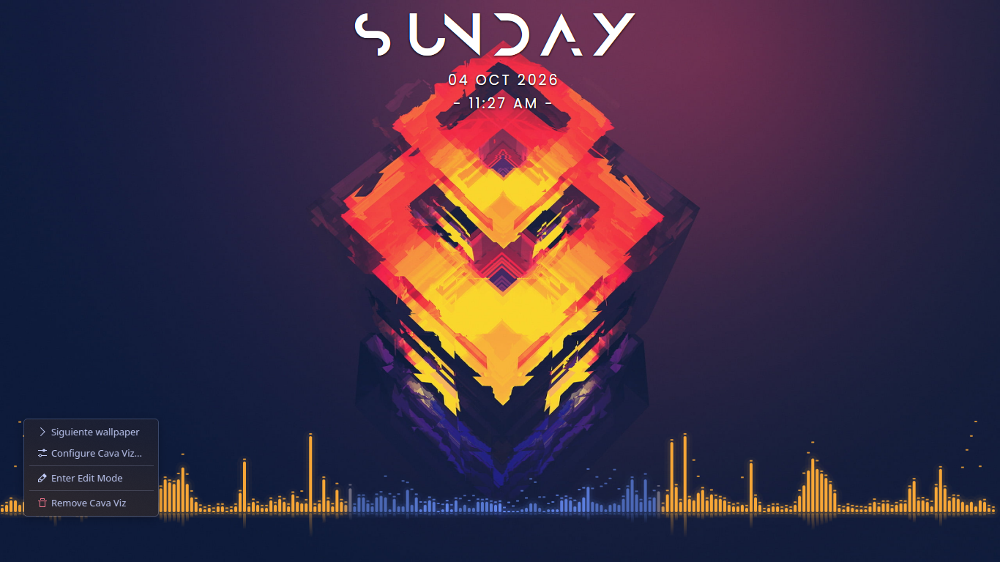
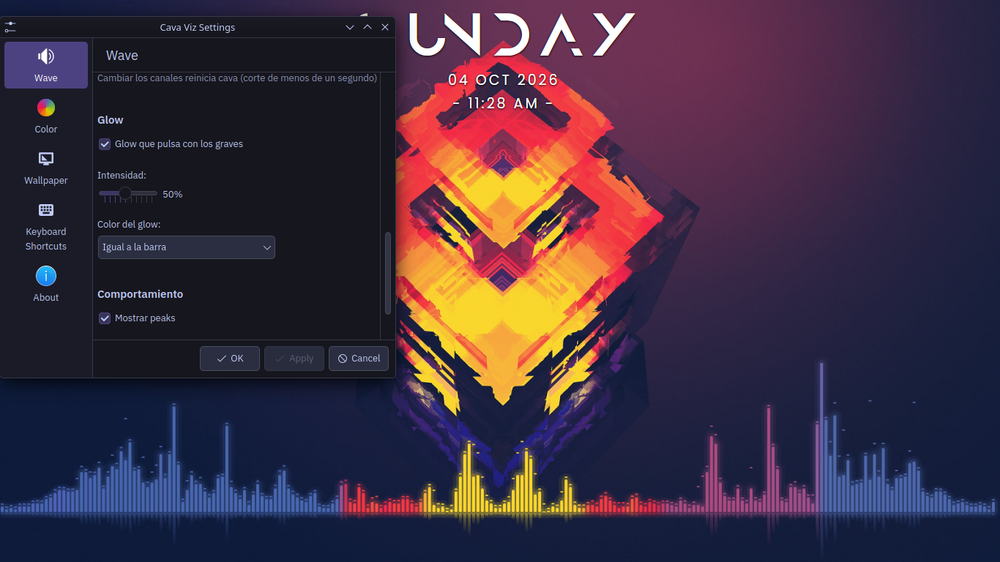
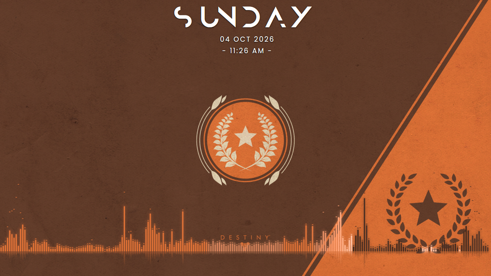
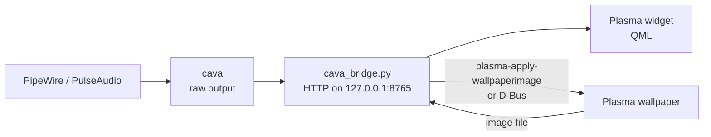

# Cava Viz

**English** | [Español](README.es.md)

An audio visualizer widget for the KDE Plasma 6 desktop. It draws thin, reactive bars directly on the wallpaper (no window, no background) and adapts its colors to the current wallpaper. It also includes its own wallpaper rotation so the colors always match the image on screen.



| Configuration panel | Another wallpaper |
|---|---|
|  |  |

## Features

**Wave**
- Bar count adjusts automatically to the widget width; you only choose bar width and gap in pixels.
- Four styles: rounded bars, square bars, wave (one smooth filled curve) and circular (bars around a circle).
- Three orientations for bars and wave: from the bottom, mirror (with an adjustable reflection line) and floating (centered).
- Smooth motion: an optional slider that eases the movement (rises faster than it falls, so beats still show).
- Stereo or mono, with normal or inverted frequency layout.
- Peak caps, hide on silence and smooth color transitions.
- Glow that pulses with the bass, using the bar color or an automatic contrasting color.

**Styles**
- Save the current look (shape, colors, glow, smooth motion) with a name and switch back with one click, plus 5 ready-made styles (Configure > Estilos).

**Color modes**

| Mode | What it does |
|---|---|
| Two colors | Bass uses the Plasma accent color and treble blends into the wallpaper color most different from it, or you pick both colors |
| By wallpaper zone | Each bar takes the color of the wallpaper area it sits under, always bright and saturated enough to be seen. Optional color swap between zones |
| Wallpaper gradient | The wallpaper's main colors (up to 4), spread from bass to treble |
| By intensity | Low bars use one wallpaper color and tall bars another: the color rises with the volume |
| Fixed color | One color you pick |
| Palette | A ready-made palette (Neon, Sunset, Ocean, Fire, Forest, Ice, Pastel, Rainbow) or your own (2 to 6 colors), spread from bass to treble |

Every wallpaper-based mode also follows a video wallpaper. On a very light or white background, bars that would not stand out get darker: a colored bar only as much as needed to stand out (same hue), a gray bar follows a gradient from white to black as the background gets lighter (white, silver, gray, black): the bridge also sends the background color behind each bar.

**Wallpaper**
- Rotation from a folder: random, alphabetical or newest first, with an interval in hours, minutes and seconds.
- "Next wallpaper" from the widget right-click menu or a keyboard shortcut.
- Reuses the folder and excluded images from the Plasma slideshow settings.
- **we-fetch shortcuts in the right-click menu:** when we-fetch manages the desktop background, the widget menu also has "Background: videos and images / only videos / only images" and "Mute background" (the bridge reads we-fetch's files and runs `we-fetch desktop show|mute`; endpoint `/wefetch`).
- **we-fetch image turns:** if [we-fetch](https://github.com/kendoulises05-svg/we-fetch) alternates images and videos on the desktop (its `we-fetch-desktop-turns` service), Cava Viz does not rotate images on top, and "Next wallpaper" asks we-fetch for the next turn.
- **Video wallpaper** (Smart Video Wallpaper Reborn plugin, the one [we-fetch](https://github.com/kendoulises05-svg/we-fetch) sets): colors come from a frame of the video being shown (found from the file plasmashell has open; via ffmpeg, cached in `~/.cache/cava-viz/frames`) and "Next wallpaper" moves the plugin to its next video. While the wallpaper is a video, timed rotation never puts an image over it: the plugin rotates its own videos.

**Resource usage**
- Pauses cava and hides the widget when a window covers it (configurable: never, fullscreen only, fullscreen or maximized, or any window covering the widget, tiling included) or the screen is locked.
- Can be turned off and on by hand from the right-click menu or a shortcut (`/toggle`); the state survives restarts.
- Pauses while cava runs in a terminal (for example Konsole), so only that one shows; optional.
- cava in Konsole with the wallpaper colors: `cava -p ~/.config/cava/terminal.conf` (`install.sh` copies `terminal.conf`; the bridge updates its colors when it starts and when the wallpaper changes).
- Color calculations are cached and only recomputed when the wallpaper, mode or widget position changes.

## Requirements

- KDE Plasma 6 (developed and tested on Kubuntu 26.04 with Plasma 6.6.6, Wayland)
- PipeWire or PulseAudio
- `cava`, `python3-pil` (Pillow) and `curl`. The installer adds the missing ones with `apt`.
- `plasma-apply-wallpaperimage` and `qdbus6` (included with Plasma)

## Installation

```bash
git clone https://github.com/kendoulises05-svg/cava-viz.git
cd cava-viz
./install.sh
```

The script installs missing dependencies, copies the cava config (it never overwrites an existing one), creates and starts the `cava-bridge` user service, and installs or updates the widget. It asks before reloading the desktop.

First time only: right-click the desktop > **Add Widgets** > **Cava Viz**, and resize it to the area you want.

Run `./install.sh` again after any update. To remove everything:

```bash
./install.sh --uninstall
```

This removes the service and the widget; your cava config and wallpapers are not touched.

## Configuration

Right-click the widget > **Configure Cava Viz**:

| Page | Options |
|---|---|
| Estilos | Save, use, replace and delete styles; ready-made styles |
| Wave | Style, smooth motion, bar width and gap, orientation, mirror line, audio channels and layout, glow, fps, pause when, pause with cava in a terminal, peaks, hide on silence |
| Color | Color mode and its options (accent blend, color swap between zones, fixed color, palette) |
| Wallpaper | Enable rotation, folder, order, interval, next wallpaper button |
| Keyboard Shortcuts | Shortcut for "next wallpaper" |

The wallpaper-based modes (two colors, zone, gradient, intensity) need Cava Viz to control the wallpaper. If Plasma's own slideshow is active, the widget falls back to the accent color (see [Known limitations](#known-limitations)).

## How it works



Plasma widgets cannot read a continuous process output, so a small Python bridge runs cava, keeps the latest frame and serves it over HTTP, bound only to `127.0.0.1`. The same bridge rotates the wallpaper, reads the image with Pillow and computes the colors for each mode.

| File | Purpose |
|---|---|
| `cava_bridge.py` | Bridge: cava process, HTTP server, wallpaper rotation, color modes, pause handling |
| `org.kendo.cavaviz/` | The Plasma widget (QML) and its configuration pages |
| `raw.conf` | Base cava config; the bridge only changes `bars` and `channels` in a runtime copy |
| `install.sh` | Installer and uninstaller |

Bridge endpoints, useful for scripting:

| Endpoint | Purpose |
|---|---|
| `/` | Latest cava frame (`P` while paused, `D` when turned off by hand) |
| `/next` | Next wallpaper |
| `/disable`, `/enable`, `/toggle` | Turn the visualizer off, on, or toggle it (survives restarts) |
| `/state` | `off` if turned off by hand, `on` otherwise |
| `/terminal?pause=1\|0` | Pause or not while another cava runs (sent by the widget) |
| `/pause`, `/resume` | Pause or resume cava (used by the widget when a window covers it) |
| `/bars?n=&ch=` | Bar count and `stereo` / `mono` |
| `/palette`, `/zones` | Wallpaper colors (JSON) |
| `/rotation?enabled=&dir=&seconds=&order=` | Rotation settings |

To bind them to keyboard shortcuts: System Settings > Keyboard > Shortcuts > Add New > Command or Script, with one of these commands:

```bash
curl -s http://127.0.0.1:8765/toggle   # turn the visualizer off / on
curl -s http://127.0.0.1:8765/next     # next wallpaper
```

## Performance

Measured on 2026-10-07 with [`tools/bench.sh`](tools/bench.sh): real 10 s average per scenario, with music playing. HP laptop, Kubuntu 26.04, Plasma 6.6.6 (Wayland). Settings: 194 bars, 45 fps, glow on, mirror, automatic color.

| Scenario | plasmashell | cava | bridge | Total |
|---|---|---|---|---|
| Widget visible (active) | 28.7% | 1.9% | 3.3% | 33.9% |
| Fullscreen | 8.5% | 0.0% | 0.0% | 8.5% |
| Turned off by hand | 8.5% | 0.0% | 0.0% | 8.5% |
| Partial tiling with "Pause when: fullscreen or maximized" (no pause) | 32.9% | 1.9% | 3.4% | 38.2% |

Styles and modes, measured on 2026-10-18 (190 bars, 45 fps, glow, mirror, video wallpaper; the total includes the ~9% of the panel and other widgets):

| Setting | plasmashell | Total |
|---|---|---|
| Rounded bars, by zone (reference) | 30.4–32.1% | 36.0–37.9% |
| Wave | 31.5% | 37.3% |
| Circular | 20.9% | 26.8% |
| Bars, by intensity | 30.4–34.0% | 36.6–40.8% |
| Wave, by intensity | 26.5% | 33.0% |
| Bars, wallpaper gradient | 28.5% | 34.4% |
| Bars, smooth motion 60% | 39.7% | 46.0% |

- Colors are computed once per color change, never per frame. "By intensity" does not compute a color per bar either: the bars are drawn once as a mask over a single vertical gradient (MultiEffect).
- Wave is one shape (`QtQuick.Shapes`, SVG path rebuilt once per frame), circular shows fewer bars (those that fit around the circle).
- Smooth motion costs ~8 points more: the bars keep moving between cava frames, so the widget redraws on every poll instead of skipping repeated frames. It is off by default.

How to read the first table:

- **plasmashell also draws the panel and the other widgets.** With Cava Viz off it measured 9.4%, so that ~9% is not Cava Viz. Cava Viz itself uses ~20% when active and ~0% when paused.
- **When paused, cava is frozen** (state `T`) and cava and the bridge drop to 0%.
- **Tiling:** with "Fullscreen or maximized", tiling does not count and the widget keeps drawing behind it. With "A window covers the widget" (the default) it pauses too.

Compared with the previous measurement (single `top` sample, plasmashell only: glow at 60 fps ~31%, glow at 30 fps ~16%, no glow at 30 fps ~13%, paused ~0%):

- **Active:** ~20% of its own at 45 fps with glow and mirror, between the previous 30 and 60 fps values. As expected: pausing on covered windows and the manual off switch added no measurable cost.
- **Improvement:** before, a maximized or tiled window paused nothing (~34% total kept running). Now Cava Viz drops to ~0% in those cases.
- Not a 1:1 comparison: the old numbers came from `top` (one sample) with other settings. From now on, `tools/bench.sh` repeats the same measurement before and after each change.

### Measure it yourself

```bash
cd ~/cava-viz && tools/bench.sh
```

The script walks you through each scenario: active, fullscreen, a window covering the widget, cava in Konsole and turned off (the last one runs on its own). Other ways to use it:

```bash
tools/bench.sh --now "glow 30 fps"     # measure only what is on screen now, no prompts
SECS=20 tools/bench.sh                 # 20 s measurements instead of 10
```

Results are saved in `~/.local/state/cava-viz/bench/`. To compare a change: measure, apply the change, measure again and compare the **total** column and the **Turned off by hand** row.

## Troubleshooting

| Problem | Check |
|---|---|
| Widget does not show bars | `curl -s http://127.0.0.1:8765/` should return numbers. If not: `journalctl --user -u cava-bridge -n 20 --no-pager` |
| Widget shows a QML error | `journalctl --user -u plasma-plasmashell -n 30 --no-pager \| grep -iE "cavaviz\|qml"` |
| All bars at 0 | cava is listening to the wrong source. List sources with `pactl list short sources` and set the `.monitor` one in `~/.config/cava/raw.conf` (`source = ...`), then `systemctl --user restart cava-bridge` |
| Wallpaper does not change | The bridge log shows the exact reason from Plasma |
| Desktop fails to restart ("start request repeated too quickly") | `systemctl --user reset-failed plasma-plasmashell` and `systemctl --user start plasma-plasmashell` |

Reload only what changed:

| Changed | Command |
|---|---|
| `cava_bridge.py` or `raw.conf` | `systemctl --user restart cava-bridge` |
| Widget files | `./install.sh` |

## Known limitations

- **Plasma slideshow:** Plasma does not expose which image its slideshow is showing (neither in its config file nor over D-Bus), so the wallpaper-based color modes need Cava Viz's own rotation.
- **Busy wallpapers:** with many small color areas, the zone mode averages them and may pick colors that do not look right.
- **Single screen:** tested with one monitor only.
- **Video wallpaper:** colors follow the video and change right at the cuts. The first time a video is shown, the bridge prepares it in the background: 2 frames per second in one low-priority pass (with VA-API hardware decoding a 125 s video takes ~4.5 s; otherwise keyframes only) and splits it into stable-color segments (scene changes). Each color response includes the next segment's colors and how many ms until it starts, and the widget schedules the change for that moment (0.25 s early, the transition length). The video time comes from a clock started when the video starts or loops; plasmashell's file read position only detects start, loop and pauses (a drift over 3 s is corrected). For **exact** sync, `install.sh` installs a copy of the video plugin in `~/.local/share/plasma/wallpapers/` (`video_plugin.py`) that only adds a report: every 0.5 s it tells the bridge the video's current second and whether it is paused (`/videopos`; it does not run on the lock screen). No commands needed: every 10 s the bridge creates the copy if missing or rebuilds it if the system plugin was updated (if the report no longer fits, it removes it and the original is used). So Plasma picks it up without restarting the desktop, it reloads only the video wallpaper (switches to image and back to video 1.5 s later; the video settings are kept): after writing a new copy and, once per Plasma session, if the wallpaper is a video but no report arrives within 15 s. `./install.sh --uninstall` deletes it. Without the copy the previous estimate is used, tunable with `VIEW_DELAY` (0.5 s) in `cava_bridge.py`. Up to 30 prepared videos are kept.

## License

GPL-3.0-or-later. See [LICENSE](LICENSE).

## Author

Kendo ([kendoulises05-svg](https://github.com/kendoulises05-svg))
